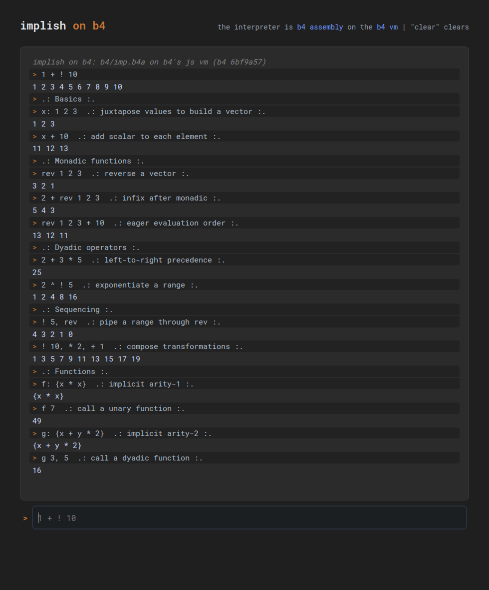

#+title: implish on the b4 vm
#+date: 2026-10-29

* goal

Michal (2026-10-29): "get implish running on my b4 vm."

Acceptance: a documented command on tcode evaluates an implish expression
on the b4 vm and prints the right result, with tests passing.

* prior intent in both repos

- implish =notes.org=: "bootstrap in js / real thing runs on tiny
  multi-core virtual machine". The TypeScript version is the bootstrap;
  the destination is a small vm.
- b4 =plan.org=: "TODO implement implish atop b4".
- b4 =goals.org=: a computing system individuals can understand from the
  ground up, built as a "trail" of tanco test suites, each layer built
  from the one below. =implish: a new dynamic language= is listed as a
  forthcoming trail, after b4f, b4s and =pre=.
- b4 =ref/tower.org=: "a tower of languages ... each language is
  implemented in terms of the layer below."
- implish =README.md=: "ultraportable" across tech stacks;
  "objects are just separate copies of the virtual machine".

* chosen approach: an implish interpreter written in b4a

Implish runs /on/ the vm: the lexer and evaluator are b4a code
(=b4/imp.b4a=), assembled into the machine by =b4i -a= on top of b4's
=pre.b4a= (parsing matchers) and an mm allocator. The host side is only
a thin driver (=b4/imp-b4.mjs=) that copies each source line into vm
ram and calls =imp-eval=; the vm itself parses, evaluates and prints.

Why:

- It is the stated intent on both sides: the vm is where implish is meant
  to live, and b4's plan names implish as a layer of its tower.
- Portability comes from b4. Every b4 implementation with a level-1
  =b4i= (=-a=, labels, =.i/.w/.f= macros) can run implish: today Rust and
  Pascal, later the others as they reach level 1. Implish gets as many
  host stacks as b4 has, which is the "ultraportable" goal.
- It is one more trail on b4's tech tree: the code needs only core ops
  plus =io 'e= for output, so a reader can follow it from =b4-tests.org=.
- It needs nothing new from b4: no new ops, no b4 changes.

The shared test file runs against /both/ the TypeScript implementation and
the b4 one, so the TS version stays the reference for semantics.

* rejected alternatives

- *implish-to-b4a compiler in TypeScript.* Faster code, but implish
  would only run where node runs; the vm would be a backend, not a home.
  It also puts the interesting part (the evaluator) outside the system you
  can inspect from the ground up. Worth revisiting later as an optimizer
  that emits b4a for hot words, once an on-vm interpreter exists.
- *TS evaluator calling a b4 vm for primitives (host ops via
  =Vm::add_op= or the JS =addOp=).* Easy, but implish isn't on the vm at
  all; it's TS with a b4 accelerator.
- *Waiting for b4s (the lisp layer) and writing implish in b4s.* That is
  the long-term tower shape, but b4s has no evaluator yet
  (=b4s.b4a= has cells, reader and printer). The milestones below are
  plain b4a on b4's =pre= and mm; once b4s can evaluate, implish's
  tree walker could move onto b4s.

* layout

| path                   | what                                                  |
|------------------------+-------------------------------------------------------|
| =b4/imp.b4a=           | the implish interpreter, in b4 assembly               |
| =b4/mm.b4a=            | memory manager: b4's mm interface, until b4's runs    |
| =$B4/b4a/pre.b4a=      | b4's parsing matchers, used by the lexer (read-only)  |
| =b4/imp-b4.mjs=        | driver: runs =b4i= with the three loaded, feeds lines |
| =b4/imp-b4=            | shell wrapper for the driver                          |
| =b4/b4-tests.org=      | tanco tests shared by the TS and b4 implementations   |
| =b4/b4-only-tests.org= | tanco tests for b4-specific behavior (errors, limits) |
| =b4/test=              | builds b4i, runs every suite above                    |
| =web/b4.html=          | the browser repl (vite: =dist-web/b4.html=, unlinked) |
| =b4/imp-b4-js.mts=     | the page's engine: b4's js vm running the ram image   |
| =b4/imp-b4-js=         | that engine as a line repl, so =b4/test= can run it   |
| =b4/mkimage.mjs=       | assembles with Rust =b4i=, writes =web/b4-image.json= |
| =vendor/b4/b4.mts=     | b4's js vm (=imp/js/b4.mts=, b4 =6bf9a57=), unchanged |

* running it

#+begin_src sh
b4/imp-b4 -e '1 + ! 10'           # 1 2 3 4 5 6 7 8 9 10
b4/imp-b4 -e '1 + 2 * 3'          # 9
echo '6 * 7' | b4/imp-b4 -q       # 42
B4I=~/ver/b4/imp/pas/b4i b4/imp-b4 -e '1 + 2'   # on the Pascal vm
b4/test                           # all suites; b4/test b4 for just the b4 ones
b4/imp-b4-js -e '1 + ! 10'        # the browser page's engine, in node
B4I=.b4-build/release/b4i node b4/mkimage.mjs   # after changing imp.b4a or mm.b4a
PATH=/usr/bin:$PATH npx vite build              # dist-web/b4.html (vite needs node >= 20.19)
#+end_src

Debugging hooks: =IMP_B4A=file.b4a= loads another interpreter, and with
=IMP_B4_RAW=1= a repl line =/b4 ...= goes to =b4i= as it is (=/b4 ?d=,
=/b4 ?8000=).

If =b4i= can't start, exits early, rejects the interpreter, or leaves
values on its data stack or mm blocks in use after a line, =imp-b4=
says so on stderr
(=imp-b4: ...=) and exits nonzero. =b4/test= treats any stderr or
nonzero exit from a run that should succeed as a failure, and has a check
for each of those failure modes.

=b4/imp-b4= builds the Rust =b4i= from =$B4= (default =~/ver/b4=) into
=.b4-build/= in this repo, so the b4 checkout is never written to.

* how the driver talks to the vm

For each input line the driver sends =b4i=:

#+begin_src b4a
imp-reset                   # once, at start: set up mm's arena
:8000 31 20 2B 20 32 00     # the source bytes, as hex, nul-terminated
8000 imp-eval               # evaluate the line at $8000 and print the result
mm-count ?d zp              # sentinel: ends this line's output
#+end_src

Hex bytes avoid any quoting of the source in b4a. The bytes go 16 per
b4i line, each with its own address, because Pascal's =b4i= truncates
long input lines. =io 'e= buffers output and =b4i= ends each line that
printed with a newline, so one =imp-eval= prints one line.

The sentinel shows the data stack with mm's count of blocks in use on
top. Both must be empty after each line (the evaluator frees every
value it makes), so the driver reports a dirty stack or a leak. An
empty result (=! 0=) prints one space, since =b4i= only ends lines
that printed something; the driver shows it as an empty line.

The driver streams lines without waiting for results (Pascal's =b4i=
buffers stdout until it exits); the =?d= sentinels split the output back
into lines, and also catch a dirty data stack. Only the interactive
prompt waits for each result, so the interactive repl needs a =b4i= that
flushes (Rust). Memory, on the Rust and Pascal vms (stacks sit at the top of the 64k):
code from =$0100= (it ends near =$0D60=; =b4/test= checks it stays
below =$8000=), the source line at =$8000= (at most 4095 bytes), and
mm's arena at =$9000=..=$F7F7=, just below the data stack (=$F7F8=). One =b4i=
process serves the whole session, so later milestones can keep variables
in vm memory across lines.

* semantics notes

- Implish evaluates infix dyads left to right with no precedence:
  =1 + 2 * 3= is =9=. The b4 version matches.
- Ints on b4 are 32-bit cells; the TS version uses js numbers. Overflow
  wraps on b4. The shared tests stay inside 32 bits; the b4-only tests
  pin the wraparound.
- Tokens follow the TS loader's =lexerTable= order, and need no space
  between them: =1+2= is the int =1= then the symbol =+2= (an undefined
  word), =12x= is =12= then =x=.
- A monad applies to the noun right after it, and dyads still go left
  to right: =! 10 + 1= is =(! 10) + 1=.
- =!10= (no space) is a =!msg2= symbol in the TS lexer, so TS itself
  rejects =1 + !10= (=invalid word class: M=). The tests write =! 10=.
- =,= : after a =,=, a verb takes the value so far as its first
  argument, as in TS: a primitive or a named lambda of arity 2 takes
  the rest of the clause as its second (=1, + 2 * 3= is =7=, =2, g 3=),
  and one of arity 1 must end the clause (=! 5, rev=; =! 5, rev 1= is
  an error); arity 0 or 3 is an error. A clause that starts with a
  noun replaces the value (=1, 2= is =2=). A call's own =,= arguments
  come first (=g 3, 5=). Tested in =m3.sep= and =m3.comma-verbs=.
- Names are resolved when they are read, as in TS: the lexer makes
  =+ - * ^ ! rev= primitive tokens, but once one of those names is
  bound (=rev: 42=, =rev: {x * 10}=), reading it gives the variable,
  also in lambdas defined before (=m3.shadow-*=). (=!= can't be bound:
  =!:= isn't a set-word, in TS either.) A noun followed by a noun is a
  sequence of expressions in TS, whose last is the value; b4 doesn't
  have sequences yet, so that is an error (=b4.shadow-juxt=).
- =name:= assigns the rest of its clause (=a: b: 5=, =1 + x: 5=).
- A lambda applies to the noun after it, like a monad (=f 3 + 1= is
  =10=). A named arity-0 lambda runs when named (=k=). Arity is the
  highest of =x= / =y= / =z= read in the body (=z= after a second =,=).
- Scope, as TS's =applyIfn=: a call saves =x=, =y= and =z=, binds its
  arguments, and afterwards puts all three back (unbinding any that
  weren't bound), so they are the only locals. Any other name assigned
  in a body is the one global variable (=m3.scope*=). One difference:
  TS restores only when the body returns, so after a failed call TS
  leaves the arguments bound; b4 restores either way (=b4.scope-error=).
- Out of memory changes nothing: a call that can't copy =x= =y= =z=
  to save them fails before binding anything, putting them back never
  allocates (so a bind that fails halfway is undone), and a failed
  assignment or verb leaves every variable as it was (=b4.oom-*=).
- Where TS makes a projection (=f=, =g 3=, =+ 1=), b4 shows the lambda
  or reports an error; those are in the b4-only suite.
- The null int =0N= is the 32-bit minimum, as =NULL_INT= in the TS
  version, so it prints the same on both.
- Error text differs for now (the TS version reports =undefined word=,
  projections etc.); errors are tested in the b4-only suite.

* milestones

** DONE milestone 1: integer literals and dyads
- decimal int literals, including negative (=-7=) and =0N=
- =+ - *= as left-to-right dyads
- print the result in decimal, like the TS repl; blank line prints nothing
- errors print =Error: ...= and the session continues
- tests: shared suite on TS and b4 (Rust), b4-only suite, both as a
  batch on Pascal b4i; =imp-tests.org= and =prim-tests.org= still pass

** milestone 2: the parser on pre
The lexer is built from =pre.b4a='s matchers (=try neg rep opt chs lit
any ws digit=), porting the rows of =imp-load.mts='s =lexerTable= the
scope below needs, tried in the same order. Milestone 1's hand-rolled
scanning is gone.

- [X] first target: =b4/imp-b4 -e '1 + ! 10'= prints
  =1 2 3 4 5 6 7 8 9 10=, as TS does (test =m2.iota-plus=)
- [X] rows: whitespace, =0N\b=, =-?\d+=, and the catch-all symbol
  (stopping at whitespace, ={}`;= and the separators =,|=)
- [X] token tree in mm: a node array whose items are tokens; a run of
  ints becomes one int array (a strand), as =collectStrand= does
- [X] the rest of the subset the demo needs: =.: :.= comments (they
  nest), =,= separators (not =,name=, TS's unquote), =name:= set-words,
  ={ }= lambdas (a nested token list)
- [ ] =[ ; ]= and =( )=: no demo line needs them yet

** milestone 3: arrays on mm
Values are int arrays with a rank and shape, allocated with mm.

- [X] header: =type rank d0 d1 d2=, then the items (cells)
- [X] =!= (iota) and itemwise =+ - *=, an atom paired with each item
- [X] =rev=, and =^= (by squaring; ints only, so no negative exponents)
- [X] variables: =x: 1 2 3=, held in a node of name/value pairs in mm;
  the leak check counts everything the variables don't own
- [X] lambdas: ={x * x}=, arity from the names =x= / =y= / =z= in the
  body; =x= =y= =z= saved, bound and put back around the call
- [ ] the rest of the incunabulum set: identity, size/shape, box,
  catenate, index/from, reshape (and rank 2)

** DONE deliverable: =web/b4.html=
A REPL page like the demo page (=web/index.html=) that runs the b4
version in the browser, built by vite into =dist-web/b4.html= and not
linked from the home page. =1 + ! 10= first, then each demo
interaction below as it comes online.

- b4's js vm (=imp/js/b4.mts=) is vendored into =web/vendor/b4/=, with
  its source path and b4 commit in a header.
- the js assembler can't read =pre.b4a= or =imp.b4a= (no =.[ .]=, no
  =>= forward refs, no strings with spaces), so =b4/mkimage.mjs=
  assembles them with the Rust =b4i= and saves the ram image and labels
  to =web/b4-image.json=; =b4/test= fails if that file is stale.
- =b4/test= runs both b4 suites on this engine too (=b4/imp-b4-js=,
  the same module the page imports), checks that the image is fresh,
  that the engine catches a leaky or stack-dirtying interpreter, and
  that =npx vite build= emits =dist-web/b4.html= without =index.html=
  linking it. A screenshot of the page is in the PR.

** the demo checklist
The interactions on implish.org's demo page, in order. Each gets a
shared tanco test whose expected output comes from TS (one session, so
=x= and =f= carry over):

| # | input              | TS output                  | done |
|---+--------------------+----------------------------+------|
| #  | input             | TS output                  | done |
|----+-------------------+----------------------------+------|
| 0  | =1 + ! 10=        | =1 2 3 4 5 6 7 8 9 10=     | X    |
| 1  | =x: 1 2 3=        | =1 2 3=                    | X    |
| 2  | =x + 10=          | =11 12 13=                 | X    |
| 3  | =rev 1 2 3=       | =3 2 1=                    | X    |
| 4  | =2 + rev 1 2 3=   | =5 4 3=                    | X    |
| 5  | =rev 1 2 3 + 10=  | =13 12 11=                 | X    |
| 6  | =2 + 3 * 5=       | =25=                       | X    |
| 7  | =2 ^ ! 5=         | =1 2 4 8 16=               | X    |
| 8  | =! 5, rev=        | =4 3 2 1 0=                | X    |
| 9  | =! 10, * 2, + 1=  | =1 3 5 7 9 11 13 15 17 19= | X    |
| 10 | =f: {x * x}=      | ={x * x}=                  | X    |
| 11 | =f 7=             | =49=                       | X    |
| 12 | =g: {x + y * 2}=  | ={x + y * 2}=              | X    |
| 13 | =g 3, 5=          | =16=                       | X    |

The tests (=demo.0= .. =demo.13=, and =demo.comments= for the comment
lines) use the demo's lines exactly, =.: ... :.= comments and all, and
their expected output came from the TS repl. =web/b4.html= runs the
same lines at startup: .

** scope: an incunabulum-sized implish
About the size of Whitney's one-page J interpreter, in implish syntax:
int arrays with a shape and rank allocated through mm; the primitives
identity, size/shape, iota, box, plus, catenate, index/from, reshape;
variable assignment; evaluation over implish's syntax, parsed with pre.

The demo needs a few things beyond that set: =rev=, =^=, =,=
pipelines, and lambdas ={x * x}= with =x= / =y=. Those are in scope
because the checklist needs them, as the smallest version that passes
each demo line.

Cut (not planned): floats and =NUM=, strings, symbols as values, the
symbol prefixes other than =x:= (=:get 'lit `quote .msg !msg2 @ann
#ish %file /refn ?err ,unq=, urls, paths), adverbs and =each=,
projections (=+[1]=), quasiquote, files and urls (=rd wr=), =load= and
=eval=, =show= / =xmls= / =look=, async, error text identical to TS
for errors the shared tests don't cover.

** later
- run the full =imp-tests.org= against the b4 version and track the count
- a native =b4i.b4a= host (b4's own self-hosted interpreter) instead of
  the node driver
- more b4 implementations as they reach b4i level 1

* asks for b4

Gaps found so far. b4 is read-only for this work, so each is flagged
here and in the PR, for a separate b4 decision:

- =b4a/mm.b4a.org= doesn't run as written, so =b4/mm.b4a= implements
  its interface (=mm-init mm-alloc mm-free=, same block header) here:
  - it isn't tangled: =goals.org= links an =mm.b4a= that doesn't exist
  - the arena is hardcoded at =$0200= (inside the code when there's no
    bios), 4k
  - =mm-data= is =lb 12=, i.e. 18 bytes, but the header is 12 bytes
  - =mm-alloc= compares the wrong values; calling it underflows the
    data stack
  - =mm-free= and =mm-claim= pass =wi='s operands in the wrong order
  - it has no tests, and no =mm-size= (implish grows arrays in place
    when the block has room)
  - once b4's mm runs, switching is a change to the driver's load order
- =pre.b4a= matches only hex numbers (=n<= is base 16, =mhex=); the
  decimal matcher is in =imp.b4a= (=imp-dec=)
- the js assembler (=imp/js=) lacks =.[ .]= quotations, =>= forward
  refs and strings with spaces, so it can't assemble =pre.b4a=
- the js vm's =ad sb ml= don't wrap at 32 bits and =dv= rounds down
  (Rust and Pascal wrap and truncate), so e.g. =3 ^ 40= differed;
  =b4/imp-b4-js.mts= subclasses the vm to wrap (vendored file unchanged)
- the js vm's ram is 4k (Rust's is 64k); the page gives it 64k
- a documented "free ram" region for guests like implish (now assumed
  =$8000=..=$F7F7=). Both b4i's data stacks start at =$F7F8=
  (=MINDATA*4=), not at =$F800=: mm's arena used to end at =$F800=, so
  the top cells of its last block were the data stack's bottom two, and
  a binding kept there was overwritten (=b4.mem-top=). Pascal's disk
  block buffer (=minbuff=..=maxbuff=, about =$F3F4=..=$F7F7=) is in this
  region too; implish doesn't use =load= / =save=.
- =io= input so the vm can read stdin itself (Rust has it; not portable yet)
